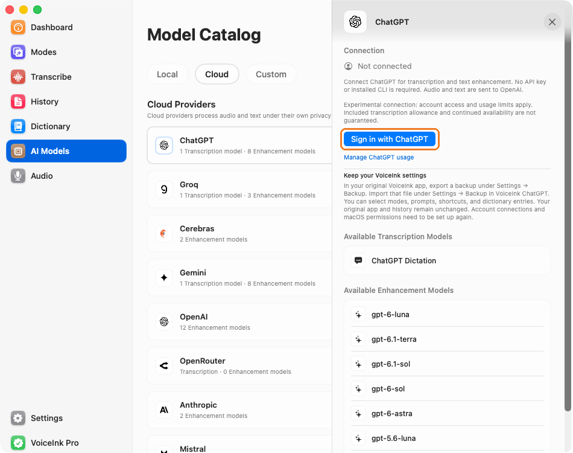
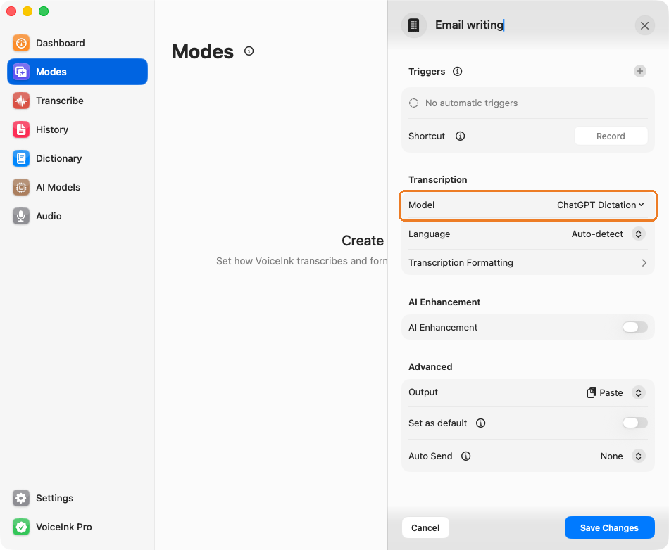
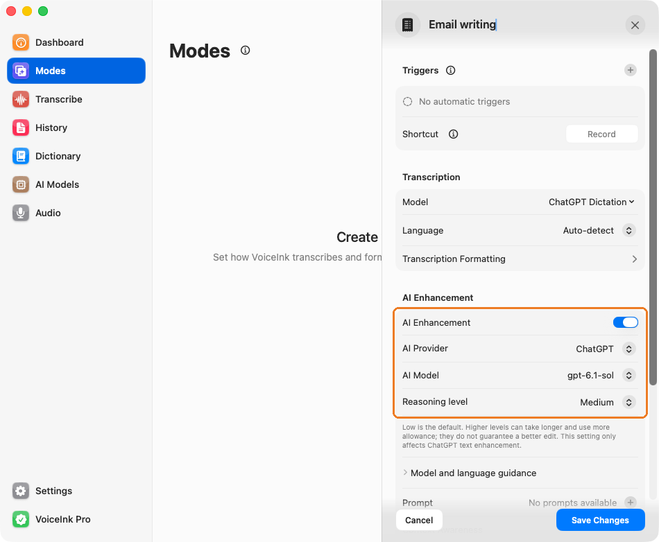

# VoiceInk ChatGPT | by Spezi

Native ChatGPT sign-in for **audio transcription and text enhancement**. No API key or installed CLI required. Based on [Beingpax/VoiceInk](https://github.com/Beingpax/VoiceInk), with separate app identity and storage so both apps can stay installed.

## ✨ Features

- Sign in with ChatGPT and transcribe recorded audio directly through ChatGPT.
- Optional text enhancement with per-mode model and reasoning selection.
- Current and earlier text-model presets, custom IDs, and model/language guidance.
- Separate settings, Keychain credentials, history and recordings from the original VoiceInk.

User-tested with **ChatGPT Plus and Pro ($100/month)**. Model access and usage limits depend on the account. This uses experimental internal endpoints; included audio minutes, billing treatment and continued availability are not guaranteed. Audio and enabled enhancement context are sent to OpenAI.

### 🔗 Connect ChatGPT

Open **AI Models → Cloud → ChatGPT**, click **Sign in with ChatGPT**, and complete sign-in in your browser. This connects your account for both transcription and optional text enhancement.

*Orange frames highlight the relevant controls in each full app screenshot.*

### 🎙️ Choose ChatGPT for transcription

Open **Modes** and add or edit a mode. Under **Transcription → Model**, choose **ChatGPT Dictation**, select your language, then **Save Changes**. This selects audio-to-text transcription independently of the text-enhancement model.

*Demo configuration; no real ChatGPT account is connected in this capture.*

### 🧠 Choose a text model and reasoning level

In the same mode, enable **AI Enhancement**, choose **ChatGPT** as the provider, then select an **AI Model** and **Reasoning level**. Each mode keeps its own selection. Presets and custom model IDs are supported; available reasoning levels depend on the model. Choose your editing prompt or add one with **+**, then click **Save Changes**.

*Demo configuration; no real ChatGPT account is connected in this capture.*

## 🚀 Install or update

Find downloads and version details in GitHub's **Releases** section. Requires macOS 15+. Ad-hoc signed, **not Apple-notarized**.

1. Quit **VoiceInk ChatGPT**. Open the DMG and drag the app to Applications, or unzip the ZIP and move the app there.
2. Replace the existing **VoiceInk ChatGPT.app** to keep its settings and data. The original **VoiceInk.app** remains separate.
3. If macOS blocks the app, use **System Settings → Privacy & Security** to approve it. Do not disable Gatekeeper.
4. Open **AI Models → Cloud → ChatGPT**, sign in and test the connection.
5. In a mode, choose **ChatGPT Dictation** and optionally enable **AI Enhancement → ChatGPT**. Select a text model and reasoning level.

## 📥 Import your VoiceInk settings

1. 📤 **Original VoiceInk:** Open **Settings → Backup** and export a settings backup (`.json`).
2. 📥 **VoiceInk ChatGPT:** Open **Settings → Backup** and import that same file. Choose **All** or **Individual categories** to select what to restore.

- ✅ **Can be transferred:** modes, custom prompts, dictionary words/replacements, keyboard shortcuts, general settings and custom model definitions.
- 🔑 **Set up again:** ChatGPT/provider sign-ins, API keys and macOS permissions.
- 🗂️ **Stay in the original app:** transcription history and audio recordings. Importing settings leaves the original app's data intact.
- ⌨️ **Avoid shortcut conflicts:** quit the other dictation app while using this one.

**Already using VoiceInk ChatGPT?** Just replace **VoiceInk ChatGPT.app** when updating. Its existing settings stay in place; no export/import is needed.

## 🛠️ Development

[Agent guide](AGENTS.md) · [Build instructions](CHATGPT-BUILD.md) · [Integration details](CHATGPT-INTEGRATION.md) · [Project status](PROJECT_STATUS.md) · [Changelog](CHANGELOG.md) · [Upstream provenance](UPSTREAM.json)

ChatGPT integration maintained by **Spezi (Codex)**. Original VoiceInk by its upstream authors. This fork is not an official OpenAI integration. Distributed under [GPL-3.0](LICENSE).
